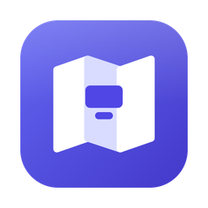
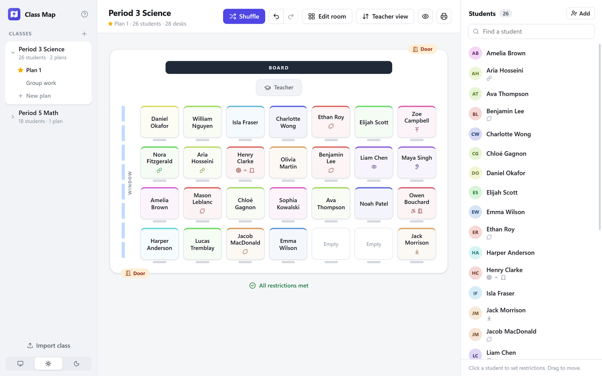
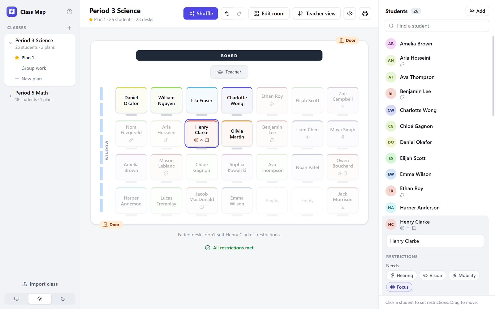
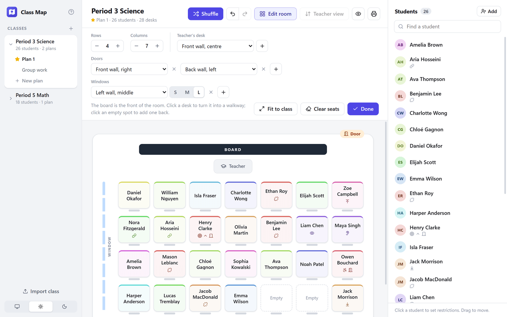
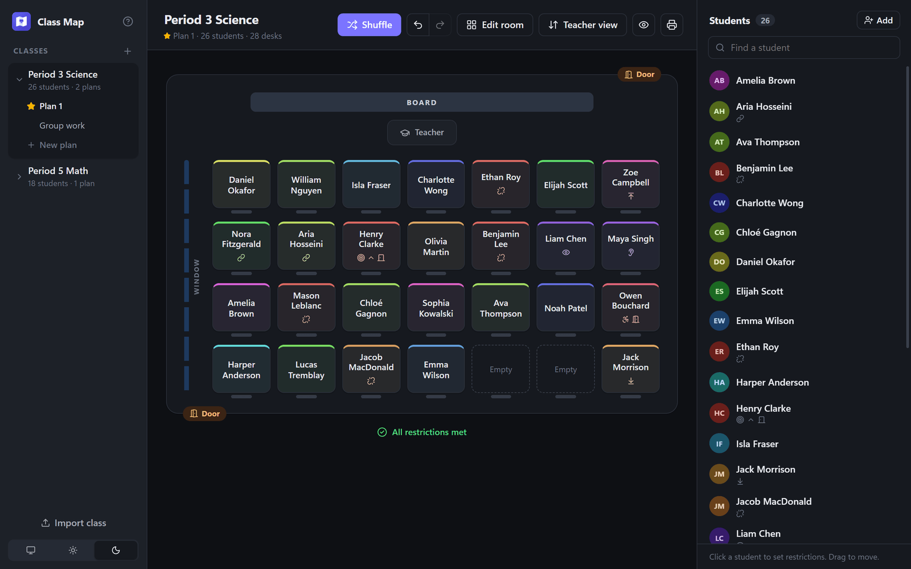

<h1 align="center">Class Map</h1>

<strong>Seating plans for your classroom, in minutes.</strong> For Windows and Mac.

<a href="https://github.com/matthewzeitler/class-map-releases/releases/latest"><strong>Download the latest version</strong></a>

Class Map makes seating plans for your classroom. Add your students, note anything they need, like a seat at the front or someone to keep them apart from, and press **Shuffle**. Class Map seats everyone so those needs are met, and you can drag students around to fine-tune it.

## What it does

- **Shuffle that follows the rules.** Every shuffle respects each student's needs. If a room can't fit them all, Class Map shows you which ones it couldn't meet.
- **Needs and restrictions for each student.** Hearing, vision, mobility, and focus; front row, back row, or end of row; near the door, near your desk, or away from windows; who they should sit next to or be kept apart from.
- **Your room as it really is.** Rows and columns, walkways, doors, windows, and teacher's desks where they actually are.
- **Several plans per class.** Keep a "Group work" or "Test day" plan alongside your usual one.
- **Discreet in front of the class.** One click hides every restriction before the plan goes on the projector.
- **Print or save a PDF.** A class copy with names only, or a teacher copy with everyone's restrictions and notes.

## Screenshots

| | |
|:-:|:-:|
|  Set each student's needs. Desks that don't suit them fade out. |  Lay the room out to match yours. |
|  Light and dark mode. |  A short setup when you first open it. |

## Download and install

Get the files from the [latest release](https://github.com/matthewzeitler/class-map-releases/releases/latest), under **Assets**.

**Windows**
- **Class-Map-…-setup.exe** installs Class Map and keeps it up to date. Pick this one if you're not sure.
- **Class-Map-…-portable.exe** runs without installing, for example from a USB stick.

**Mac**
- **Class-Map-…-arm64.dmg** is for Macs with Apple silicon (M1 or newer). **Class-Map-…-x64.dmg** is for older Intel Macs. Not sure? Apple menu → **About This Mac**: "Chip: Apple M…" means arm64.

### Opening it the first time

Class Map isn't code-signed yet, so your computer warns you once.

- **Windows:** if you see "Windows protected your PC", click **More info**, then **Run anyway**.
- **Mac:** open the .dmg and drag Class Map into Applications. When you first open it, macOS says it can't verify the app. Click **Done**, then go to **System Settings → Privacy & Security**, scroll down, and click **Open Anyway**.

## Your classes stay with you

Class Map works without an internet connection. Your classes are saved on your own computer and aren't uploaded anywhere. To move a class to another computer, export it to a file from the sidebar and import it there.

## Updates

The Windows installer checks for new versions when it starts and updates itself. On a Mac, or with the portable version, download the new version from the [releases page](https://github.com/matthewzeitler/class-map-releases/releases) when one comes out. Each release lists what's new.
